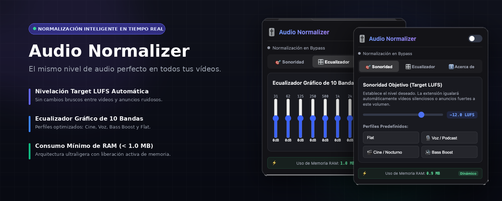

<p align="center">
  
</p>

<h1 align="center">🎚️ Audio Normalizer & Equalizer</h1>

<p align="center">
  <b>Controlador de Sonoridad Inteligente & Ecualizador Gráfico de 10 Bandas en Tiempo Real</b><br>
  <i>Nunca más te sobresaltes con anuncios atronadores ni te esfuerces por escuchar vídeos silenciosos en Google Chrome.</i>
</p>

<p align="center">
  <a href="https://developer.chrome.com/docs/extensions/mv3/intro/"></a>
  <a href="https://developer.mozilla.org/en-US/docs/Web/API/Web_Audio_API"></a>
  <a href="LICENSE"></a>
  <a href="https://github.com/AdelysAlberto/volumen"></a>
</p>

---

## 📌 Visión General

**Audio Normalizer & Equalizer** es una extensión nativa para **Google Chrome** (Manifest V3) que analiza e iguala automáticamente el sonido de cualquier pestaña en tiempo real mediante algoritmos de **Control Automático de Ganancia (AGC)** y el estándar industrial de sonoridad (**Target LUFS**).

Procesa el sonido de YouTube, Netflix, Twitch, Spotify Web, podcasts y conferencias online en segundo plano de forma continua, libre de fugas de memoria y con un consumo insignificante de RAM (< 3 MB).

---

## ✅ Qué Resuelve

* 🔊 **Elimina anuncios comerciales atronadores**: Atenúa instantáneamente los picos de volumen fuertes para proteger tus oídos.
* 🎙️ **Amplifica vídeos silenciosos**: Eleva limpiamente las voces y diálogos débiles sin introducciones de distorsión o ruido.
* 🎧 **Evita el ajuste manual constante**: Mantiene todo el audio navegable exactamente en el mismo nivel de confort deseado.
* 🌙 **Ideal para reproducción nocturna**: Disfruta de películas y series sin despertar a nadie en casa.

---

## ⚡ Características Principales

* 🎯 **Control de Sonoridad Objetivo (Target LUFS)**: Selecciona tu nivel ideal (-24.0 a -8.0 LUFS) e iguala todo el contenido web.
* 🎛️ **Ecualizador Gráfico de 10 Bandas**: Filtros paramétricos de 31Hz a 16kHz (-12 dB a +12 dB) para ajustar graves, medios y agudos.
* 🎙️ **Perfiles Predefinidos (Presets)**: Selección rápida en 1 clic entre *Flat*, *Voz/Podcast*, *Cine/Nocturno* y *Bass Boost*.
* 🔄 **Procesamiento 24/7 en Segundo Plano**: Desarrollado sobre la arquitectura *Offscreen Document* de Manifest V3; continúa activo al cambiar de pestaña o cerrar el menú.
* ⚡ **Monitor Dinámico de Memoria RAM**: Visualización en tiempo real del uso de RAM V8 con liberación automática de recursos.
* 🔒 **100% Privado y Local-First**: Sin recolección de datos, el audio se procesa completamente dentro de tu navegador.

---

## 🚀 Instalación Rápida en Chrome

### 1. Vía Modo Desarrollador (Manual)

1. Abre **Google Chrome** (o Brave, Arc, Edge).
2. Ingresa a la barra de direcciones: `chrome://extensions`
3. Activa el **Modo de desarrollador** (esquina superior derecha).
4. Haz clic en **"Cargar descomprimida"** (*Load unpacked*).
5. Selecciona la carpeta del repositorio:
   ```text
   /Users/adelysalberto/Projects/utils/volumen
   ```
6. ¡Listo! Abre cualquier vídeo en YouTube y disfruta del volumen normalizado.

---

## 📦 Guía de Publicación en la Chrome Web Store

El repositorio cuenta con el script y paquete ZIP preparado para subir a la tienda oficial de Google Chrome:

```bash
# Generar paquete distributivo ZIP
zip -r AudioNormalizer-v1.0.0.zip manifest.json background.js popup offscreen icons LICENSE README.md
```

1. **Google Console**: Ingresa al [Chrome Web Store Developer Console](https://chrome.google.com/webstore/devconsole).
2. **Subir ZIP**: Haz clic en *"Agregar nuevo elemento"* y sube `AudioNormalizer-v1.0.0.zip`.
3. **Declaración DSA / EEE**: Selecciona *"Esta es una cuenta de no comerciante"* para mantener tus datos personales privados.
4. **Ficha y Privacidad**: Sube las capturas de pantalla, la marquesina [`assets/marquesina_1400x560.png`](file:///Users/adelysalberto/Projects/utils/volumen/assets/marquesina_1400x560.png) y declara que el procesamiento es 100% local.

---

## 🏗️ Arquitectura del Repositorio

```text
volumen/
├── manifest.json              # Especificación Manifest V3 (activeTab, tabCapture, offscreen)
├── background.js              # Service Worker evento-orientado en segundo plano
├── offscreen/
│   ├── offscreen.html         # Documento offscreen persistente
│   └── offscreen.js           # Motor Web Audio API (HighPass, 10-Band EQ, AGC Compressor, GainNode)
├── popup/
│   ├── popup.html             # Interfaz gráfica por pestañas (Sonoridad, Ecualizador, Acerca de)
│   ├── popup.css              # Tokens CSS Dark Glassmorphic
│   └── popup.js               # Controlador de interfaz y monitor dinámico de memoria RAM
├── assets/
│   └── marquesina_1400x560.png# Banner promocional oficial
├── icons/                     # Iconos PNG de resolución 16x16, 48x48 y 128x128
├── LICENSE                    # Licencia de código abierto MIT
└── README.md                  # Documentación canónica del repositorio
```

---

## 👨‍💻 Autor y Mantenimiento

Desarrollado y mantenido por **Adelys Alberto Belen** ([@AdelysAlberto](https://github.com/AdelysAlberto)).

* **Rol**: Software Engineer
* **Sitio Web**: [adalbeca.com](https://adalbeca.com)
* **Contacto / Email**: [dev@adalbeca.com](mailto:dev@adalbeca.com)

---

## 📄 Licencia

Este proyecto está distribuido bajo la licencia **MIT**. Consulta el archivo [LICENSE](LICENSE) para más detalles.
